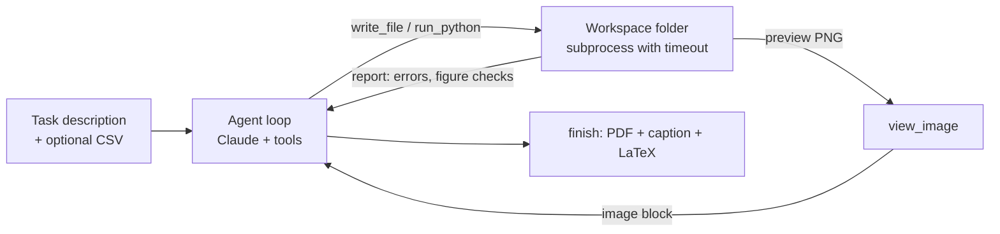

# Paper Assistant Agent

Two small LLM tools for writing ML papers:

1. **Figure agent.** Describe a figure or a toy example, for instance "accuracy vs. epoch with seed bands from this CSV", "flow-matching interpolation paths on two moons", or "phase portrait of a damped oscillator". The agent writes the matplotlib script, runs it, reads automatic figure checks, *looks at* the rendered preview, and revises until the figure is ready for a paper. You get the script, a vector PDF, a caption, and a LaTeX snippet.
2. **LaTeX polisher.** Tightens the wording of a paragraph. A deterministic check makes sure every math expression, `\cite`, `\ref` and `\label` comes back unchanged.

```text
write script -> run_python (exit code, output, figure checks, preview) -> view_image -> revise -> ... -> finish
```

## How it works



| Tool | What it does |
|---|---|
| `read_file`, `list_files` | Inspect data files and scripts in the workspace |
| `write_file` | Write a script (only `.py`, `.csv`, `.txt`, `.json`, `.tex`, `.md`, inside the workspace) |
| `run_python` | Run a script with a timeout. Every figure it saves is checked and rendered to a preview automatically |
| `view_image` | Send a preview PNG back to the model as an image, so it can see its own figure |
| `finish` | Final answer: figure files, caption, LaTeX `figure` environment (strict schema; files must exist) |

**Automatic figure checks** (`figlint.py`): missing axis labels (shared axes and `supxlabel` count), text smaller than 7 pt at the saved size, figures wider than a page, several labeled series without a legend, and no vector file. The trick is in `_boot.py`: scripts run under a small bootstrap that patches `Figure.savefig`, so every saved figure is checked and previewed without the script having to cooperate.

**Polisher** (`polish.py`): one structured-output request returns `{revised, changes}`. A regex then extracts the protected spans (inline and display math, equation environments, `\cite`, `\ref`, `\eqref`, `\label`, `\url`) before and after. If any differ, the model gets the exact list and tries again. The CLI prints a word diff.

**Task suite** (`tasks/`): eight tasks. Two are data figures from CSVs (training curves with seed bands, an ablation bar chart; the data is synthetic, from `tasks/make_data.py`). Six are toy examples: flow-matching paths, momentum on Rosenbrock, a damped-oscillator phase portrait, a logistic-map bifurcation diagram, a Gaussian-mixture density, and the Lorenz attractor.

## Quickstart

```bash
pip install -r requirements.txt
python -m pytest                     # offline tests (scripted model); no API key needed
```

The agent uses the [Anthropic API](https://docs.anthropic.com/). Set `ANTHROPIC_API_KEY`, then:

```bash
python -m paper_assistant figure "Phase portrait of x'' + 0.3x' + x = 0 with three RK4 trajectories" --out figs/oscillator
python -m paper_assistant figure "Mean and std of val_acc over seeds per method" --data results.csv --out figs/curves --verbose
python -m paper_assistant polish intro.tex --instructions "keep it under 120 words"
python -m paper_assistant bench --limit 2          # part of the task suite
python -m paper_assistant bench                    # all 8 tasks
python -m paper_assistant bench --method oneshot   # ablation: one script, run once, no feedback
```

Flags: `--model` (default `claude-opus-5-5`), `--effort low|medium|high`, `--max-tool-calls`. Each task folder keeps the script, the PDF, the previews and `_result.json` (or `_transcript.json`) with the full transcript. The printed cost is an estimate from a hard-coded price table.

## Results

<!-- Add after running `bench` and `bench --method oneshot`:
| Method | Clean figures (8) | Mean script runs | Mean previews viewed | Cost |
|---|---|---|---|---|
| Agent (claude-opus-5-5, medium) | x/8 | x | x | $x |
| One-shot | x/8 | 1 | 0 | $x |
and add 2-3 of the generated figures to the README. -->

## Design notes

- **Two kinds of feedback.** The deterministic checks are cheap and reliable but narrow. Looking at the preview catches what they cannot: overlapping text, a legend covering data, wasted space, a plot that answers the wrong question.
- **LLM proposes, code verifies.** The polisher never trusts the model's claim that the math is unchanged; it checks. The figure agent's `finish` is rejected if the listed files do not exist.
- **The loop is hand-written** (`make_figure` in `figure_agent.py`): a tool budget, one reminder if the model answers in prose, and a saved transcript. The `oneshot` ablation measures what the feedback loop adds.
- **Safety.** The model's code runs locally in a subprocess with a timeout, confined to the workspace folder for file writes. That is not a real sandbox; use a container for anything you would not run yourself.

## Limitations

- The checks say nothing about scientific correctness. Read the script, especially for toy simulations.
- Each preview costs image tokens, so the tool budget also bounds cost.
- The polisher protects spans by syntax; changes in meaning still need a human read.

## License

MIT
